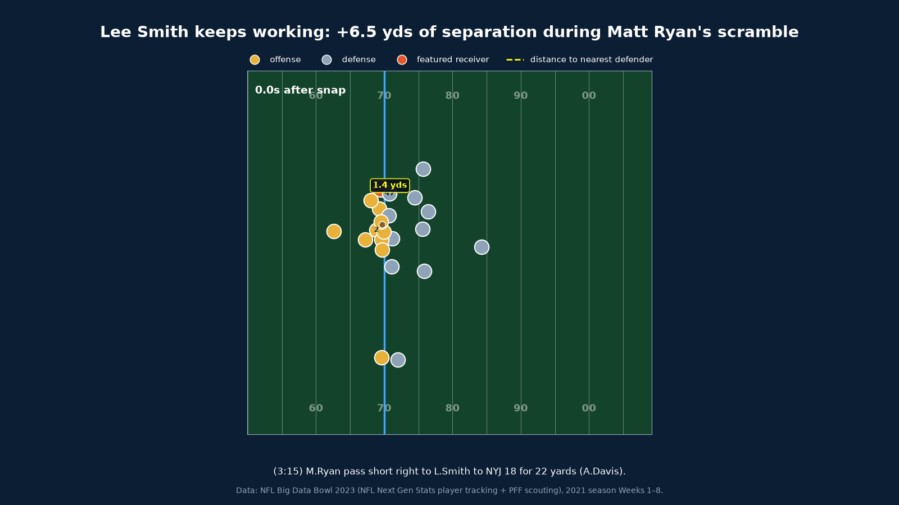
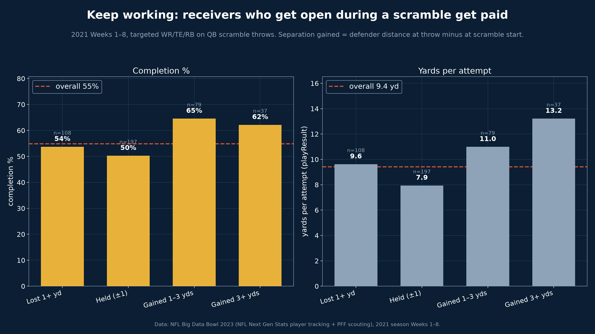
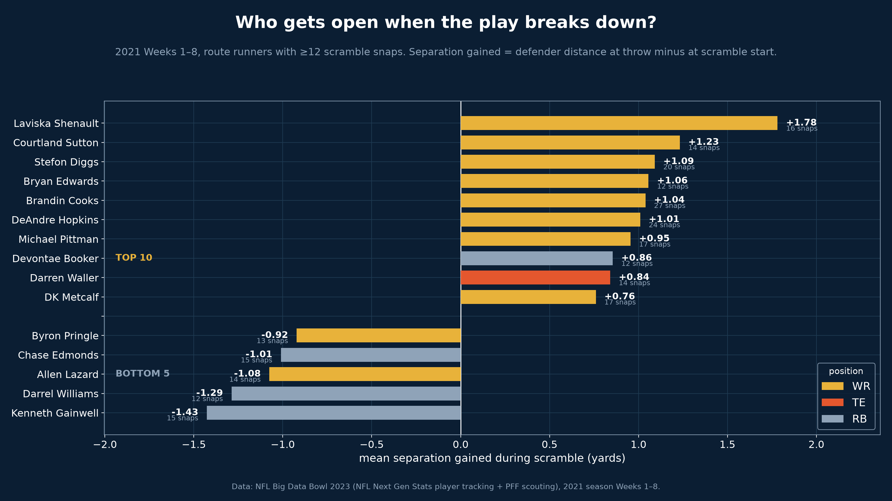

# Scramble Drill Score

When the play breaks down, which receivers keep working to get open, and does it matter?



*Lee Smith goes from 0.6 to 7.1 yds of separation during Matt Ryan's scramble -> Complete, 22 yds.*

## TL;DR

We built a metric that measures how much separation a WR, TE, or RB gains between the moment the QB leaves the pocket and the moment he throws.

Receivers who gained 1+ yard of separation completed 64.6% of targets for 10.99 yards each, while receivers who just held steady completed only 50.3% for 7.94 yards.

This matters even more because QBs threw to the most open receiver on only 27.3% of scrambles, and scramble throws are already harder (55.2% complete vs 67.3% on normal dropbacks).

Coaches can drill and grade scramble rules, scouts can compare receivers, and broadcasters can explain broken plays live.

## The insight



Get open and you get paid: gaining separation during a scramble lifts completion rate and yards per attempt well above the average.

## Is it real, or just noise?

We tested it. On scramble throws (n=421):

- **Separation predicts completions.** A logistic regression of completion on separation at the throw is highly significant (p < 0.001). Each extra yard of separation multiplies the odds of a completion by 1.23x.
- **The gap is significant.** Receivers who gained 1+ yard completed 63.8% vs 50.3% for those who held even. That +13.5 point lift has a two-proportion z-test p = 0.020, with a bootstrap 95% confidence interval of [2.3, 24.8] points.
- **So are the yards.** Gainers averaged 11.70 yards per attempt vs 7.94 (t-test p = 0.013).

All three point the same way: creating separation during a scramble genuinely helps.

## Who gets open when the play breaks down



The top three are all wide receivers: Laviska Shenault, Courtland Sutton, and Stefon Diggs. The bottom of the board is full of running backs, who start open in the flat and get run down.

## Coaching takeaway

- Receivers: keep working after the QB breaks the pocket. Gaining 1+ yard of separation during the scramble is worth about +14.3 completion percentage points over just holding your ground.
- QBs: keep your eyes up. The most open receiver gets the ball on only 27.3% of scrambles.

## How we measured it

| Term | What it means |
|---|---|
| Scramble throw | Dropback tagged SCRAMBLE that ended in a pass (complete, incomplete, or INT) |
| Scramble start | First moment the QB moves more than 3 yards sideways from where he took the snap |
| Separation | Distance from the receiver to the nearest defender in coverage |
| Separation gained | Separation at the throw minus separation at scramble start |
| Target / result | Receiver named in the play description; result from plays.csv |

Data: 2021 NFL season Weeks 1-8 Next Gen Stats tracking (10 frames/sec) + PFF scouting data; 559 scramble throws, 426 targeted receivers.

## Assumptions & limitations

- Tracking ends 0.5s after the throw, so catch-point and yards after catch are not measured; outcomes come from plays.csv.
- Scramble start is a simple 3-yard rule, not a hand-labeled moment.
- Separation uses the nearest defender, not necessarily the defender assigned to that receiver.
- "Most open" does not account for throw distance or difficulty.
- The overall effect is statistically significant (see "Is it real, or just noise?"), but per-player rankings rest on small samples (12-27 scramble snaps each), so individual names are directional, not definitive.

## Run it

```bash
pip install -r requirements.txt
python main.py   # regenerates every chart and GIF in output/
```

File map:

- `main.py` — one command; runs the pipeline and builds every chart and GIF.
- `src/load.py` — reads the CSVs and normalizes tracking direction.
- `src/scramble.py` — finds scramble plays and the snap/throw/scramble-start moments.
- `src/metric.py` — computes each receiver's separation gained.
- `src/target.py` — finds the targeted receiver and attaches the play result.
- `src/charts.py` — builds the payoff chart and the leaderboard.
- `src/animate.py` — builds the showcase and side-by-side play GIFs.
- `src/style.py` — shared colors and fonts.
- `output/` — all generated charts, GIFs, and cached data.

## Built with

Python (pandas, numpy, matplotlib, seaborn). Developed with Kiro.
